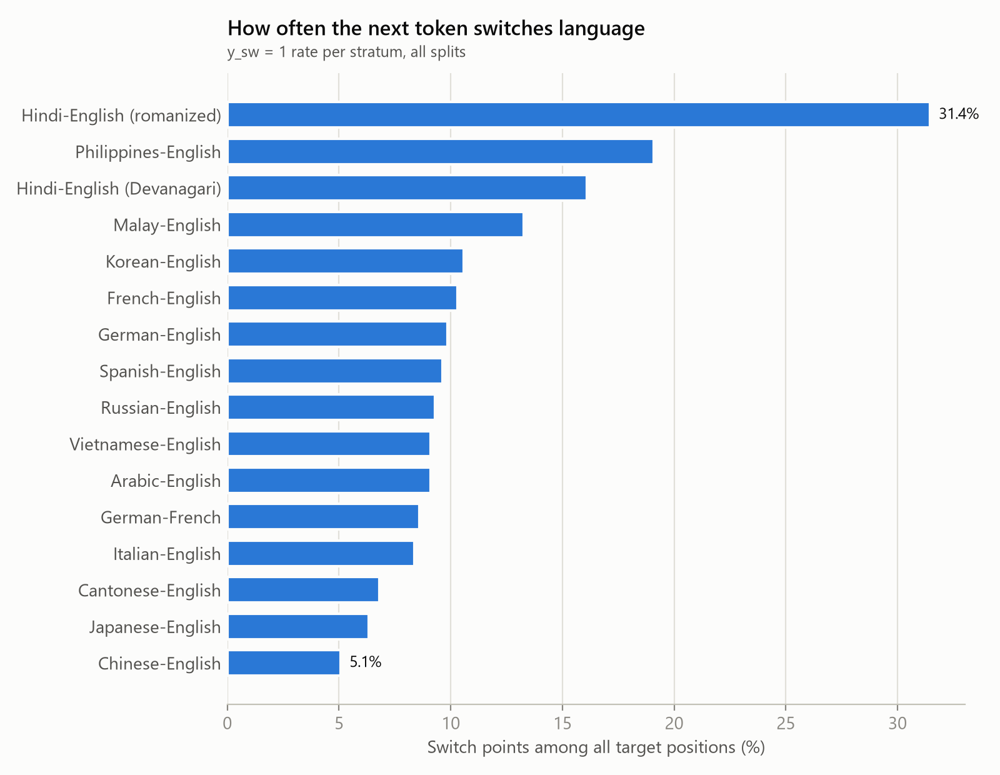
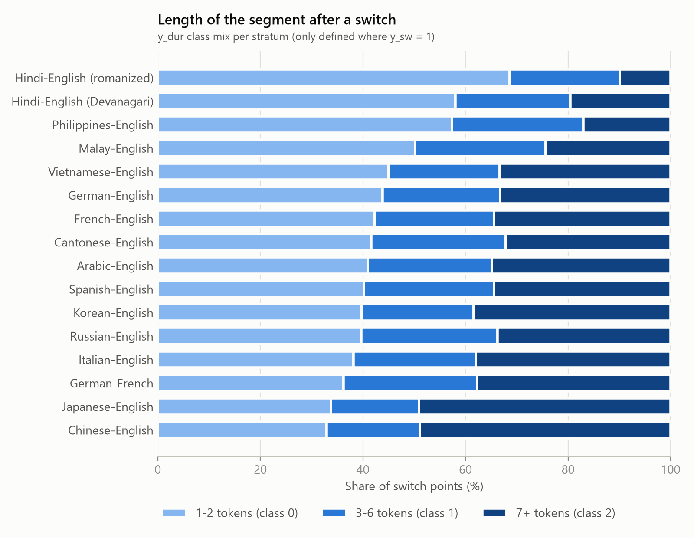
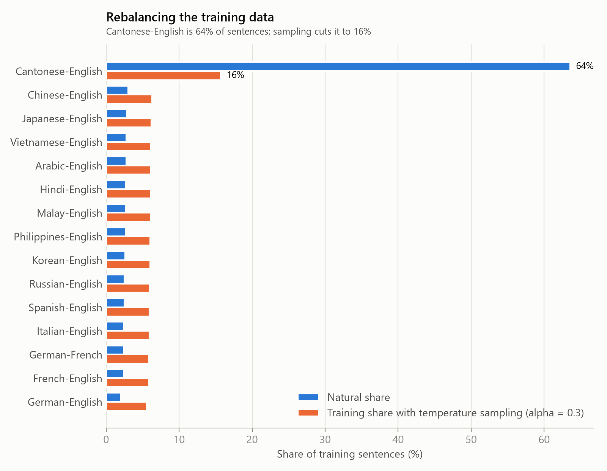
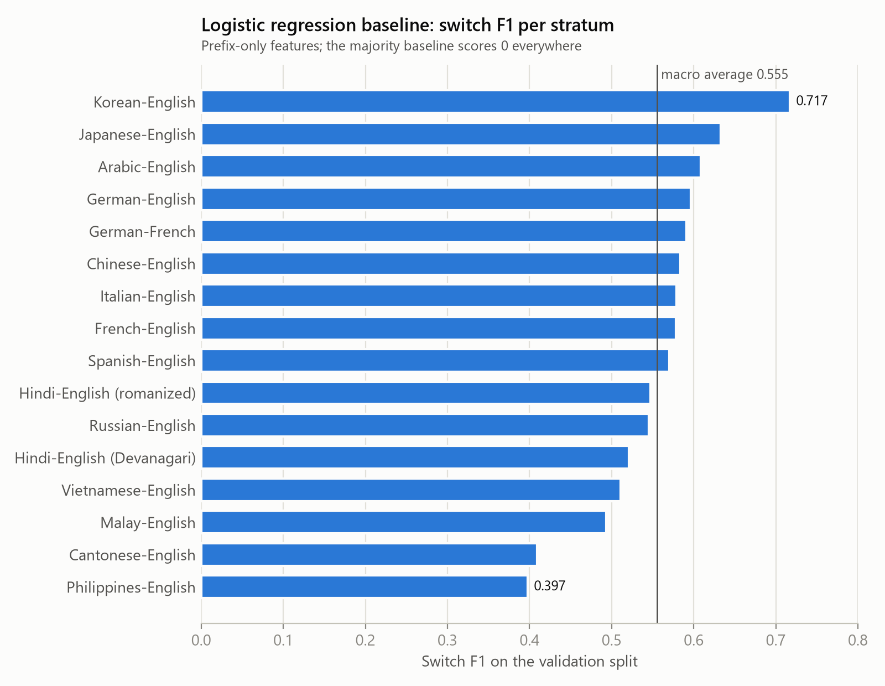

# SwitchLingua progress report: weeks 4 to 6

**Project:** Predictive Multitask Learning for Streaming Code-Switching
**Scope of this report:** week 4 (clean text, map language IDs), week 5 (switch and duration labels), week 6 (streaming loader and baselines).
**Status:** all three milestones are complete. Model training starts in week 8 and is not part of this report.

Each section ends with a *Slide* note suggesting what to put on the corresponding slide.

---

## 1. The task in one picture

At every word *t* of a sentence, using **only words 1..t**, predict:

| Target | Type | Definition |
|---|---|---|
| `y_sw` | binary | 1 if word *t+1* is in a different language than word *t* |
| `y_dur` | 3 classes | when `y_sw = 1`: length of the new language segment starting at *t+1*: **1-2**, **3-6** or **7+** tokens |

Example (Spanish-English): *Yo no sé, but I think so*

| Word | Yo | no | sé, | but | I | think | so |
|---|---|---|---|---|---|---|---|
| Language | es | es | es | en | en | en | en |
| `y_sw` | 0 | 0 | **1** | 0 | 0 | 0 | (none) |
| `y_dur` | | | **3-6** (4 tokens) | | | | |

The last word has no *t+1*, so it gets no target. `y_dur` exists only at switch points.

*Slide:* the task definition and this example.

---

## 2. Week 4: clean text and map language IDs

### 2.1 What the dataset actually contains

We inspected `Shelton1013/SwitchLingua_text` (pinned version `6e048d27`) before writing any code.

| Finding | Consequence |
|---|---|
| **15 language pairs**, not 12: 14 X-English pairs plus German-French (the paper lists 12 languages; Malay, Filipino, Vietnamese and German-French were added in the released text) | The project covers all 15 pairs |
| 234,172 conversations, flattened to **974,994 sentences** | Unit of prediction = one sentence |
| **Cantonese-English is 64% of sentences** (619,863); every other pair has 20k to 30k | Needs rebalancing (section 4.2) |
| The text column is a stringified Python object written by an LLM. Most rows are lists of sentences, but some are dicts (`{'topic', 'instances'}`, `{'speaker', 'message'}`), nested lists, or bare strings (91 rows) | A parser that handles every format and keeps only text fields |
| 5 sentences were empty or were whole conversations pasted into one string | Removed and counted per pair, never silently |
| **No word-level language tags** are provided | We built our own tagger (2.3) |

### 2.2 Tokenization

One tokenizer shared by every model, so all models are scored on identical targets:

- words are split on whitespace and punctuation (`didn't`, `week-end` stay whole);
- **each Chinese character is one token** (the mBERT rule), since Chinese, Cantonese and Japanese do not separate words with spaces;
- hiragana and katakana runs are separate tokens; digits form one token.

### 2.3 Language identification per token

Each token gets one of its row's two languages, by three rules applied in order:

1. **Script rule.** If the token's alphabet belongs to only one of the two languages, that decides it. This fully covers the 7 pairs whose other language is not written in Latin script (Arabic, Cantonese, Chinese, Hindi, Japanese, Korean, Russian).
2. **Frequency rule.** For the 8 Latin-script pairs, compare the word's frequency in each language (`wordfreq` Zipf scale). A gap of 0.3 or more decides it. The gap is small because the Malay and Filipino word lists contain many English loanwords ("public" scores nearly as high in Malay as in English).
3. **Context rule.** Undecided tokens (names, numbers, words common to both languages like *no* or *me*) take the language of the nearest decided neighbor, preferring the left one.

Labels may use the whole sentence; only model **inputs** must be prefix-only (section 4).

### 2.4 Romanized Hindi

**56% of Hindi-English rows are written entirely in Latin script** ("Logon ko acting bahut pasand aayi"), so the script rule tagged their Hindi words as English.

Fix: a romanized-Hindi word list built from the corpus itself (`src/resources/roman_hindi.tsv`, 1,056 words). The reference for "English in this kind of text" is the **Latin words inside Devanagari rows**, which are all English insertions. Words frequent in romanized rows but almost absent from that reference are Hindi (*hai, mujhe, bahut, main*). A first attempt that compared against general English frequencies wrongly flagged words this corpus simply overuses (*honestly, especially*), which is why the in-corpus reference matters.

Hindi-English is now reported as two strata: **Devanagari** and **romanized**.

### 2.5 Checking the tags

**Automatic proxy check** (300 rows per pair): correlation between our per-row share of second-language tokens and the ratio estimated by the dataset's own LLM evaluator.

| Pair | Correlation | | Pair | Correlation |
|---|---|---|---|---|
| Spanish-English | 0.60 | | Arabic-English | 0.47 |
| German-English | 0.60 | | French-English | 0.51 |
| Japanese-English | 0.59 | | Chinese-English | 0.51 |
| Vietnamese-English | 0.57 | | Malay-English | 0.51 |
| Cantonese-English | 0.56 | | Korean-English | 0.50 |
| Russian-English | 0.55 | | Hindi-English | 0.32 (was 0.14 before the romanized fix) |
| German-French | 0.53 | | Philippines-English | 0.29 |
| Italian-English | 0.52 | | | |

The LLM estimate is itself noisy, so this is a sanity check, not an accuracy. **Hand validation** sheets are ready in `results/lid_check/` (30 sentences per pair, 450 in total, one token per line); the team fills the `gold` column where a tag is wrong and `python -m scripts.lid_check score` reports token accuracy and switch-point F1 per pair. **This is the one open item from week 4.**

*Slides:* (1) dataset findings table; (2) the three LID rules with one example sentence per rule; (3) romanized Hindi before/after.

---

## 3. Week 5: switch and duration labels

### 3.1 Labels

Implemented in `src/labels.py` exactly as defined in section 1, with unit tests on hand-worked sentences (Spanish, Arabic tag switch, Cantonese insertion, long clausal switch, one-word sentence).

### 3.2 Splits

- **80 / 10 / 10** train / val / test by **conversation** (sentences of one conversation never cross splits).
- **Stratified** by pair, with Hindi split by script (16 strata).
- Conversations that share an identical sentence (5,586 duplicate sentences, mostly Cantonese) are kept in the same split, so no sentence appears in both train and test.
- Fixed seed (13), saved in `results/splits/row_splits.csv.gz` and reused on every machine.

| Split | Conversations | Sentences |
|---|---|---|
| train | 187,329 | 778,867 |
| val | 23,418 | 98,046 |
| test | 23,422 | 98,081 |

### 3.3 What the labels look like



- Switches are **rare**: 5% to 13% of positions for most pairs (8.1% pooled). Accuracy is therefore misleading; we report precision, recall, F1 and PR-AUC.
- Hindi (romanized) is an outlier at 31%. It may be genuine heavy mixing or tagging noise; the hand validation will tell.



- Chinese and Japanese have the most **7+** segments: their segments are counted in characters, so they look longer.
- Hindi and Filipino are dominated by **short insertions** (1-2 tokens).
- The middle class (3-6) is the smallest in 12 of 16 strata; in the two Hindi strata, Filipino and Malay, 7+ is the rarest.

**Known effect to mention:** a segment that reaches the end of the sentence is counted as is, so long segments near sentence ends may be undercounted (right-censoring).

*Slides:* (1) split design; (2) switch rate figure; (3) duration mix figure.

---

## 4. Week 6: streaming loader and baselines

### 4.1 Streaming loader (`src/streaming.py`, `src/dataset.py`)

Each sentence is encoded once with the model's own subword tokenizer. With a causal model, the output at subword *i* depends only on subwords 0..*i*, so one pass gives a prediction for every prefix: equivalent to feeding the windows [x1..xt] one by one, and much faster.

The prediction for word *t* is read at the last subword that ends before word *t+1* starts. Two safeguards make leakage impossible:

- **Straddle check:** if a subword covers the end of word *t* and the start of word *t+1*, that position is skipped.
- **Retokenization check:** the subwords up to the prediction point must equal the tokenization of the prefix alone (in text without spaces, a tokenizer can split earlier characters differently depending on what follows).

**Leakage tests:** for every position, replacing all text after word *t* must not change the model inputs up to *t*. This passes for both tokenizers on Spanish, Cantonese and Hindi examples.

**Tokenizer alignment** (300 training sentences per stratum):

| Stratum | Usable positions, XLM-R | Usable positions, XGLM | XGLM unknown-token rate |
|---|---|---|---|
| Chinese-English | 69% | 75% | 0.6% |
| Japanese-English | 78% | 85% | 0.2% |
| Cantonese-English | 80% | 85% | **5.4%** |
| Korean-English | 99.9% | 96% | 0.6% |
| All 12 other strata | 99.9% or more | 97% to 99.7% | 0% |

In Chinese-character text, subwords often span several characters, so 20% to 30% of character positions cannot be predicted without seeing the next character. **True switch points are never lost for XLM-R** (XGLM loses 4% to 5% in Chinese and Cantonese). XGLM's vocabulary lacks common Cantonese characters (冇, 佢, 咁). Consequence for weeks 10 to 12: compare models on the positions valid for **both**.

### 4.2 Rebalancing with temperature sampling



Pair *p* is drawn with probability proportional to n_p^0.3, the exponent used for XLM-R and mT5 pretraining. Cantonese drops from 64% to 16% of training samples (about 2.6 times any other pair instead of 25 times), and no data is thrown away. "Overall" metrics are **macro averages over strata**, so Cantonese cannot dominate the evaluation either. Equal sampling (alpha = 0) is planned as an ablation.

### 4.3 Baselines (validation split)

| Model | Switch F1 | Switch PR-AUC | Precision | Recall | sigma of F1 across strata | Duration macro-F1 | Duration accuracy |
|---|---|---|---|---|---|---|---|
| Majority class | 0.000 | 0.114 | 0.000 | 0.000 | (n/a) | 0.202 | 0.441 |
| **Logistic regression** | **0.555** | **0.528** | 0.550 | 0.571 | **0.076** | **0.531** | 0.636 |

Macro averages over 16 strata, 1.8 million validation positions.

- **Majority class** always predicts "no switch" and the most frequent duration class.
- **Logistic regression** uses prefix-only features: current language, length of the current run, switches so far, position, punctuation typed after the word, script of the word, stratum, and stratum x current language. Trained on 3,000 sentences per stratum. The switch threshold (0.225) was chosen on training data, never on the evaluated split.
- **Feature leakage guard:** the stored tags can use the right-hand neighbor (context rule), so features are rebuilt from tags visible in the prefix only; a test checks that changing later words never changes a feature.



**Reading the baseline:**

- Easiest: Korean (0.72), Japanese (0.63), Arabic (0.61). Hardest: **Filipino (0.40)** and **Cantonese (0.41)**.
- Much of the signal is punctuation: inter-sentential switches tend to follow a sentence end, which a prefix model can see.
- Duration: the 3-6 class is hardest (only 13% of true 3-6 segments are recognized); 1-2 and 7+ are easier.

| Duration confusion (rows = true, all strata) | pred 1-2 | pred 3-6 | pred 7+ |
|---|---|---|---|
| true 1-2 | 56,337 | 3,011 | 5,777 |
| true 3-6 | 17,264 | 4,737 | 14,357 |
| true 7+ | 10,395 | 3,914 | 31,844 |

This is the bar the transformer models must beat in weeks 8 to 10.

*Slides:* (1) streaming loader and leakage guarantee; (2) rebalancing figure; (3) baseline table; (4) per-stratum F1 figure.

---

## 5. Design decisions we should be ready to defend

| Decision | Why |
|---|---|
| One model-independent tokenization for labels | Both models are scored on identical targets |
| A Chinese character is one token | Standard (mBERT) and avoids three new word segmenters; downside: Chinese segments look longer |
| Rule-based LID instead of a trained tagger | No word-level gold labels exist; rules are transparent and checked by hand validation |
| Romanized Hindi word list from the corpus | `wordfreq` has no romanized Hindi; in-corpus English is the right reference |
| Labels may use right context, features may not | Labels are ground truth; only inputs must respect the streaming constraint |
| Split by conversation, duplicates grouped | Prevents near-identical text in train and test |
| Temperature sampling (alpha = 0.3) + macro averages | Standard multilingual practice; keeps all data while balancing pairs |
| Threshold chosen on training data | Tuning on the evaluated split would inflate scores |

---

## 6. Open items and limitations

1. **Hand validation of the LID tags** (450 sentences in `results/lid_check/`): needed to report tagging accuracy, and to settle the romanized Hindi switch rate (31%) and the weaker Filipino tags.
2. **Right-censoring** of segments at sentence ends (section 3.3).
3. **Tokenizer gaps** in Chinese-character text, and XGLM's missing Cantonese characters (section 4.1).
4. **Environment notes:** Windows Application Control blocks part of scikit-learn on one laptop, so the logistic regression is implemented in PyTorch; full model training needs a GPU (Colab notebook in `notebooks/train_colab.ipynb`).

## 7. Next: weeks 7 to 10

- Week 7: causal masking and model heads (implemented and tested in advance: a causality test confirms that later tokens cannot change earlier outputs).
- Week 8: multitask training of XLM-R (causal mask) and XGLM-564M.
- Week 9: loss weights and class imbalance.
- Week 10: backbone comparison against these baselines.

---

## Reproducing these numbers

```bash
python -m scripts.prepare_data           # processed data and summary (splits are reused)
python -m scripts.check_alignment        # tokenizer alignment table
python -m scripts.baselines              # majority and logistic regression on val
python -m scripts.make_report_figures    # the four figures in this report
python -m pytest -q tests                # 57 tests: labels, splits, leakage, metrics
```

Sources: `results/data_summary.csv`, `results/alignment/`, `results/runs/majority_val_seed13/`, `results/runs/logreg_val_seed13/`.
